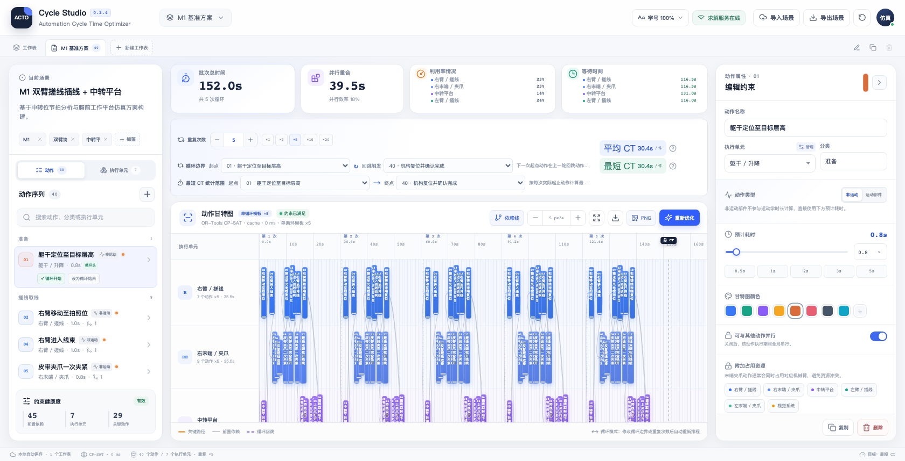

# ACTO

**Automation Cycle Time Optimizer** 是面向双臂轮式机器人的动作级节拍仿真软件。

当前版本：`0.2.3`

[GitHub 仓库](https://github.com/botoph4/ACTO) ·
[完整使用说明书（PDF）](docs/ACTO-Cycle-Studio-使用说明.pdf) ·
[局域网系统](http://10.8.1.106:18090)



## 项目介绍

ACTO Cycle Studio 用于把机器人作业拆解为动作级任务，并在执行单元、动作耗时、前置依赖和资源互斥约束下计算最短循环时间。系统使用 OR-Tools CP-SAT 求解排程，并通过甘特图展示动作顺序、并行关系、瓶颈单元、关键路径和批量折算 CT。

工程团队可以用它比较不同工位布局、机械臂分工和动作顺序，在机械设计与控制程序落地前快速评估节拍方案。系统支持多工作表、循环边界、重复批次、手动调整、场景 JSON/CSV 导入导出和完整甘特图 PNG 导出。

当前版本支持公司局域网账号登录。管理员可以创建或删除普通账号和管理员账号；每名用户的工作表按账号保存在当前浏览器，并通过 JSON 导出进行跨设备交接。

项目位于：

```text
~/Documents/develop/ACTO
```

## 启动

```bash
cd ~/Documents/develop/ACTO
npm run dev
```

- 前端：<http://localhost:5173>
- API 文档：<http://localhost:8000/docs>

首次在新机器安装：

```bash
npm install
npm run install:all
```

## 局域网部署

生产环境会把前端静态页面和后端 API 放在同一个端口：

```bash
cd /home/xingchen/acto
./.venv/bin/pip install -r backend/requirements.txt
npm --prefix frontend ci
npm --prefix frontend run build
./deploy/start.sh
```

首次启动前复制 `.env.example` 为 `.env`，设置管理员账号、密码和端口。账户保存在
`backend/data/acto.db`，密码使用 PBKDF2 哈希，登录令牌有效期为 7 天。管理员登录后可从
右上角账户菜单创建其他管理员或普通用户。

## 已实现

- 多账号登录：PBKDF2 密码哈希、7 天会话、管理员创建与删除账号，并显示在线状态和最近活跃时间。
- 多工作表：新建、切换、重命名、复制和删除；工作表状态自动保存在浏览器本地。
- 重复批次：同一套动作模板只维护一份；快速设置重复次数，界面实时显示单循环时间、批次总时间和“总时间 ÷ 次数”的折算 CT。
- 循环回跳：可设置循环起点动作和回跳触发动作，例如“01 在 04 完成后进入下一轮”；求解器会展开迭代并优化跨迭代流水。
- 动作序列内设置循环边界：选中动作后可直接设为“循环开始”或“循环结束”，循环头/尾会同步标记到甘特条。
- 甘特图编号：色块只显示动作编号，编号与左侧动作列表一一对应；悬停可查看完整名称、起止时间和耗时。
- 甘特条名称：色块同时显示动作编号和动作名称；窄条自动换行，执行单元行高根据该行最高色块自适应。
- PNG 导出：工具栏“PNG”按钮可导出完整时间范围的甘特图，包括所有执行单元、循环实例、依赖线和动作名称。
- 甘特图拖拽：拖动色块调整开始时间，拖动左右边缘调整动作时长；“清除手动”或“重新优化”可恢复自动最短 CT。
- 运动时长自动计算：动作可标记为运动部件或非运动部件；运动部件根据行程、最大速度和加速度，通过梯形速度规划自动计算时长，同时支持人工覆盖和恢复自动计算。
- 前置延时等待：所有前置依赖完成后，可额外等待指定时间再开始动作；甘特条右下角时长使用更醒目的字号。
- 动作编辑：名称、颜色、耗时、执行单元、分类、统一前置依赖、并行开关和附加占用资源。
- CP-SAT 排程：同一执行单元串行、跨单元并行、完成-开始依赖、全局互斥及资源占用。
- 结果分析：最短 CT、关键路径、并行重合时间、执行单元利用率和瓶颈。
- 重复 CT 对比：同时显示折算平均 CT 与相邻循环间的最短 CT。
- 优化结果缓存：输入未变化时，再次“重新优化”直接复用之前的解，不重复调用求解器。
- 导入导出：完整场景 JSON、Excel 可维护的动作表 CSV。

## 导入什么文件

### 场景 JSON

推荐使用 ACTO 导出的 `.json` 文件。它保留执行单元、动作颜色、统一前置依赖和全部工程属性。

### 动作 CSV

支持 UTF-8 `.csv` 动作表，适合先在 Excel 中维护。列名可以直接使用 ACTO 导出的中文表头：

```text
任务ID, 动作名称, 分类, 执行单元, 预计耗时(s),
运动类型, 运动行程(mm), 最大速度(mm/s), 加速度(mm/s²), 时长模式, 甘特图颜色,
前置依赖, 可与其他动作并行, 附加占用资源, 备注
```

依赖 ID 和附加资源使用 `|` 分隔。旧版 CSV 中的“必须停止后执行”列会在导入时自动合并进前置依赖。CSV 导入会创建一个新工作表，并沿用当前工作表的执行单元定义。

当前不直接解析 Excel `.xlsx/.xls`。请先在 Excel 中选择“另存为 → CSV UTF-8”。

## 求解算法

当前使用 OR-Tools CP-SAT。该问题包含离散资源互斥、有限容量和确定性优先关系，属于约束调度问题；CP-SAT 可以得到最优解或明确标记时间上限内的可行解。

当前 40 动作示例在本机的重复基准约为 **5–8 ms**。遗传算法属于随机启发式，
通常需要大量迭代，且无法像 CP-SAT 一样证明最优性，因此在这个规模下不会更快或更可靠。
只有在未来模型扩展到数百个动作、加入非线性目标，或 CP-SAT 经常达到时间上限时，才建议评估“CP-SAT + 遗传算法热启动”的混合方案。

为避免异常输入造成长时间等待，单次求解上限设为 2 秒；相同请求会命中缓存。

## 目录

```text
ACTO/
├── frontend/          React + TypeScript + Vite
├── backend/           FastAPI + OR-Tools CP-SAT
├── docs/              预览图、说明和 PDF 使用手册
├── deploy/            局域网启动与存活检查脚本
└── package.json       一键启动脚本
```

## 版权与联系

Copyright: Agile Robot ISA Control

联系人：xingchen.li@agile-robots.com
